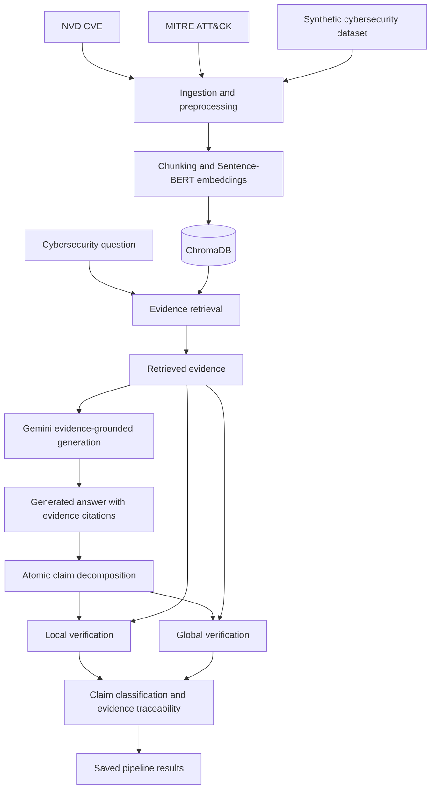

# Evidence-Grounded Hallucination Detection for Cybersecurity RAG Systems

An evidence-grounded Retrieval-Augmented Generation (RAG) research project for cybersecurity question answering. The system retrieves cybersecurity evidence, generates a cited response, decomposes that response into atomic claims, and verifies each claim against the retrieved evidence.

> **Research focus:** Claim-level verification and evidence traceability in cybersecurity RAG systems.

## Overview

Cybersecurity questions require precise, source-backed answers. A RAG system can retrieve relevant documents and generate a response, but a fluent answer may still contain claims unsupported or contradicted by the retrieved material.

This project explores a verification layer for cybersecurity RAG. It checks individual claims in a generated answer against retrieved evidence and preserves evidence references so verification decisions can be inspected.

## Research Problem

How can a cybersecurity RAG system identify answer claims that are supported by retrieved evidence, contradicted by that evidence, or not substantiated by it, while retaining traceability to the evidence used for verification?

## Objectives

1. Build a searchable evidence collection from cybersecurity sources.
2. Retrieve relevant evidence for cybersecurity questions.
3. Generate answers constrained to retrieved evidence and include citations.
4. Decompose generated answers into atomic claims.
5. Evaluate claims through local and global verification stages.
6. Classify claims and retain evidence references and reasoning for analysis.

## System Workflow

1. **Data ingestion:** Load NVD CVE records, MITRE ATT&CK data and synthetic cybersecurity records.
2. **Preprocessing and chunking:** Normalize evidence records and split text into retrieval chunks.
3. **Embedding:** Encode chunks with Sentence-BERT. The current `all-MiniLM-L6-v2` model produces 384-dimensional embeddings.
4. **Vector storage and retrieval:** Store embeddings in ChromaDB and retrieve relevant evidence for a query.
5. **Answer generation:** Use Gemini to generate an answer from retrieved evidence, with citations such as `[E1]`.
6. **Claim decomposition:** Split the generated answer into atomic claims.
7. **Local verification:** Calculate semantic similarity between each claim and individual evidence passages. This is a candidate-support signal, not proof of entailment.
8. **Global verification:** Evaluate claims against retrieved evidence and return a verdict with evidence references.
9. **Classification and reporting:** Map verification outcomes to claim labels and save the complete pipeline result.

## Architecture



## Datasets

The current ingestion snapshot contains:

| Source | Role | Records |
|---|---|---:|
| NVD CVE JSON | Vulnerability evidence | 3,862 |
| MITRE ATT&CK CSV, version 11.1 | ATT&CK evidence merged with STIX | 1,443 |
| MITRE ATT&CK STIX, version 11.1 | Additional ATT&CK evidence | 446 |
| Synthetic cybersecurity dataset | Additional evidence and separate evaluation set | 3,530 |

The validated ingestion output contains **9,281 searchable evidence records** and **15,777 ATT&CK relationships**. Synthetic evaluation answers are kept separate from searchable evidence to avoid ground-truth answer leakage.

These counts describe the current development snapshot and may change when datasets are updated or ingestion is rerun.

## Technology Stack

| Component | Technology |
|---|---|
| Language | Python |
| Embeddings | Sentence Transformers, `all-MiniLM-L6-v2` |
| Vector database | ChromaDB |
| Retrieval experiments | Semantic search, BM25 and hybrid retrieval |
| Answer generation | Gemini API (`gemini-3.5-flash-lite` in the current implementation) |
| Verification | Local similarity verification and Gemini-based global verification |
| Data sources | NVD, MITRE ATT&CK and synthetic cybersecurity data |
| Interface | Command-line pipeline; Streamlit frontend module |

## Claim Verification and Classification

The research's primary classification labels are:

| Label | Meaning |
|---|---|
| **ENTAILED** | Retrieved evidence supports the claim. |
| **CONTRADICTED** | Retrieved evidence contradicts the claim. |
| **BASELESS** | The claim is not substantiated by retrieved evidence. |

The implementation also records two supplementary diagnostic statuses:

- **NOT_IN_EVIDENCE:** For claims explicitly describing information absent from the retrieved evidence.
- **UNVERIFIED:** When a technical or validation error prevents a reliable verification decision.

These are diagnostic statuses, not additional primary research classes.

### Local and Global Verification

- **Local verification** compares an atomic claim with individual evidence chunks using embedding similarity. Similarity helps identify candidate passages; it does not by itself establish factual entailment.
- **Global verification** assesses the claim against retrieved evidence and records a verdict, reasoning and evidence references.

## Repository Structure

```text
cybersecurity-rag-hallucination/
├── backend/
│   ├── generation/       # Gemini answer generation
│   ├── ingestion/        # NVD and MITRE ingestion and validation
│   ├── retrieval/        # Chunking, embeddings, ChromaDB and hybrid search
│   ├── verification/     # Claim decomposition and verification
│   └── main.py           # End-to-end command-line pipeline
├── data/
│   ├── raw/              # Local source datasets (not committed)
│   ├── processed/        # Generated pipeline data (not committed)
│   └── evaluation/       # Evaluation data/results (not committed)
├── evaluation/           # Retrieval evaluation scripts and metrics
├── frontend/             # Streamlit application
├── tests/
├── test_classifier.py
├── test_global_verifier.py
├── requirements.txt
└── README.md
```

Raw datasets, generated processed data, evaluation outputs, the local ChromaDB database, virtual environments and environment files are excluded from Git. They must be prepared locally before running the complete pipeline.

## Setup

### Prerequisites

- Python 3.11 (developed with Python 3.11.9)
- Git
- A Gemini API key from Google AI Studio
- The source datasets listed above

### 1. Clone the Repository

```bash
git clone https://github.com/Gowthamm08/cybersecurity-rag-hallucination.git
cd cybersecurity-rag-hallucination
```

### 2. Create and Activate a Virtual Environment

**Windows PowerShell**

```powershell
py -3.11 -m venv .venv
.\.venv\Scripts\Activate.ps1
```

If PowerShell blocks activation in the current terminal session:

```powershell
Set-ExecutionPolicy -Scope Process -ExecutionPolicy Bypass
.\.venv\Scripts\Activate.ps1
```

### 3. Install Python Dependencies

```bash
python -m pip install --upgrade pip
python -m pip install chromadb sentence-transformers requests python-dotenv pandas numpy
```

### 4. Configure the Gemini API Key

Create a `.env` file in the project root:

```env
GEMINI_API_KEY=your_gemini_api_key_here
```

Never commit or share the real key. The repository's `.gitignore` excludes `.env`.

### 5. Prepare Datasets and Vector Storage

Place the NVD, MITRE ATT&CK and synthetic dataset files in the expected locations under `data/raw/`. These files and the generated ChromaDB store are intentionally not included in this repository.

Run ingestion:

```bash
python -m backend.ingestion.unified_ingestion
```

Then generate the retrieval chunks and embeddings and initialize the persistent ChromaDB collection using the project's retrieval scripts. The local database is expected under `vector_store/chromadb/`.

> A fresh clone does not contain the ignored datasets or vector database. These local artifacts must be prepared before running the complete pipeline.

## Run the Pipeline

After preparing the datasets and ChromaDB collection and configuring `.env`:

```bash
python -m backend.main
```

Enter a cybersecurity question at the prompt. Type `exit` or `quit` to stop.

## Output

The end-to-end pipeline writes its latest result to:

```text
data/processed/full_pipeline_results.json
```

The output includes the question, generated answer, retrieved evidence and source metadata, decomposed claims, local verification results, global verdicts and evidence references, and final claim classifications.

This output is generated locally and is excluded from version control.

## Limitations

- Retrieval quality depends on the coverage, freshness and quality of ingested datasets.
- Embedding similarity is not a substitute for logical entailment or contradiction checking.
- The current generation and global-verification stages use Gemini, so their errors may be correlated. Independent verifier models and stronger benchmark-based evaluation are useful future improvements.
- A successful single pipeline run demonstrates execution, not overall classification accuracy. Accuracy claims require systematic evaluation against labelled test data.
- API availability, quotas and network connectivity can affect generation and verification.

## Team

**Project:** Evidence-Grounded Hallucination Detection for Cybersecurity RAG Systems  
**Project ID:** PW_27_SAS_02  
**Project Guide:** Ms. Shridevi A Sawant

| Team member | SRN |
|---|---|
| GOWTHAM B | PES1UG24CS172 |
| CHANDRAKANTH V G | PES1UG25CS810 |
| C NITISH | PES1UG25CS809 |
| DEEKSHITH GOWDA G | PES1UG24CS142 |

---

*This is an academic capstone project under development. Results and capabilities should be interpreted in the context of the current development stage.*
